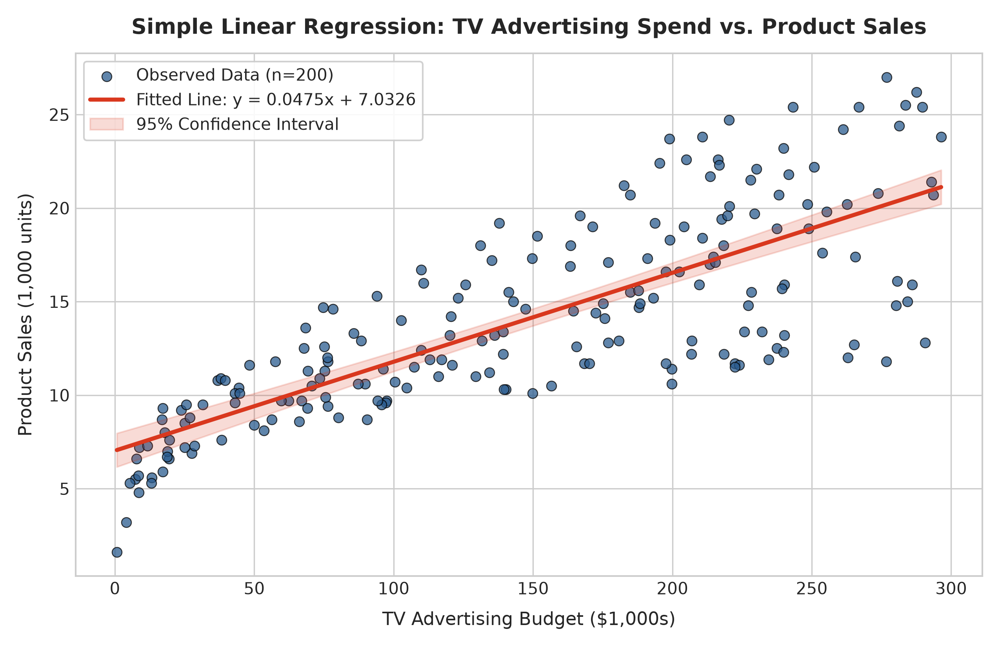
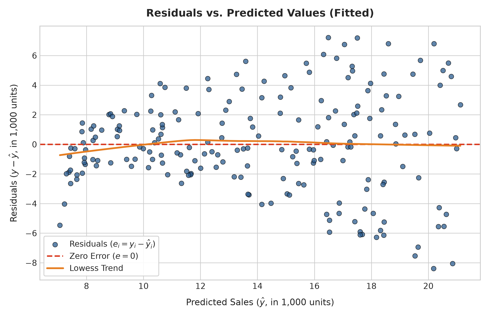
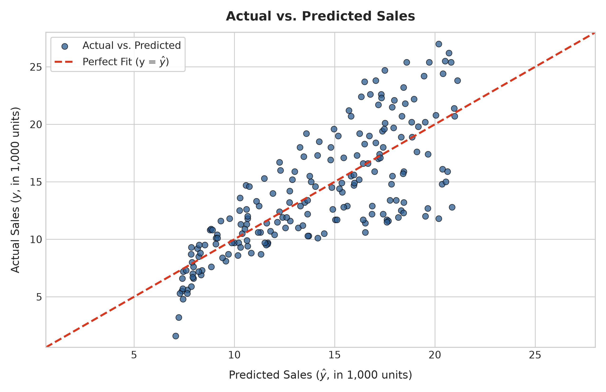
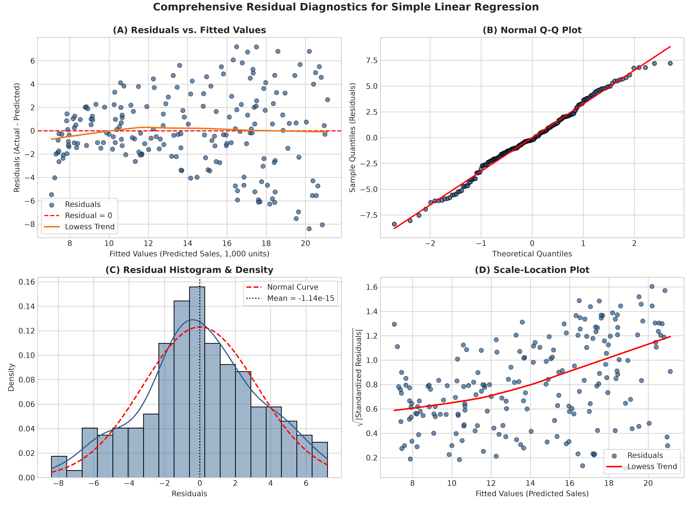

# UpStartInterns Machine Learning Engineering — Task 01: Regression by Hand

A comprehensive, production-grade statistical and machine learning project demonstrating **Simple Linear Regression implemented from scratch by hand** using closed-form Ordinary Least Squares (OLS) mathematical formulas (without using `scikit-learn` to fit the manual model), verified against `scikit-learn`, with parameter interpretations in plain English and in-depth residual diagnostics.

---

## 📋 Table of Contents
- [Project Overview](#-project-overview)
- [Objective & Requirements Checklist](#-objective--requirements-checklist)
- [Dataset Description](#-dataset-description)
- [Mathematical Formulation (Regression by Hand)](#-mathematical-formulation-regression-by-hand)
- [Key Results & Regression Equation](#-key-results--regression-equation)
- [Manual Implementation vs. Scikit-Learn Verification](#-manual-implementation-vs-scikit-learn-verification)
- [Sample Predictions & Residuals](#-sample-predictions--residuals)
- [Interpretation of Coefficients in Plain English](#-interpretation-of-coefficients-in-plain-english)
- [Visualizations & Plots](#-visualizations--plots)
- [Residual Analysis & Diagnostics Discussion](#-residual-analysis--diagnostics-discussion)
- [Machine Learning Validation (80/20 Train/Test Split)](#-machine-learning-validation-8020-traintest-split)
- [Repository Structure](#-repository-structure)
- [Installation & How to Run](#-installation--how-to-run)
- [UpStartInterns Submission Guide](#-upstartinterns-submission-guide)

---

## 🎯 Project Overview
In marketing analytics and machine learning engineering, understanding the foundational mechanics of parametric modeling is essential. The goal of this task is to construct a **Simple Linear Regression** model from scratch without relying on machine learning libraries to compute the parameters, verify the results against `scikit-learn`, evaluate underlying Gauss-Markov assumptions via residual diagnostics, and interpret the model coefficients within the business context.

---

## ✅ Objective & Requirements Checklist

| Requirement | Implementation Detail | Status |
| :--- | :--- | :---: |
| **1. Real Dataset Loading** | Loaded 200 real market campaign records from `dataset.csv` using `pandas` | ✅ Completed |
| **2. Data Inspection** | Audited missing values ($0$), data types (`float64`), shape ($200 \times 4$), and summary stats | ✅ Completed |
| **3. Variable Selection** | Selected $X = \text{TV}$ ($r = 0.7822$) and $y = \text{sales}$ based on correlation & business problem | ✅ Completed |
| **4. Regression by Hand** | Derived and computed slope $m$ and intercept $b$ using closed-form OLS formulas without sklearn | ✅ Completed |
| **5. Sklearn Verification** | Fitted `LinearRegression()` separately and verified exact equivalence via programmatic assertions | ✅ Completed |
| **6. Equation & Residuals** | Displayed $y = 0.0475x + 7.0326$, slope, intercept, actual values, predicted values, and residuals | ✅ Completed |
| **7. Coefficient Interpretation** | Explained intercept (baseline sales) and slope (incremental sales lift per $\$1,000$ spend) in words | ✅ Completed |
| **8. Performance Metrics** | Computed MAE ($2.5498$), MSE ($10.5127$), RMSE ($3.2423$), and $R^2$ ($0.6119$) by hand and verified | ✅ Completed |
| **9. Diagnostic Plots** | Generated and saved all required plots in `figures/` (scatter line, residuals vs pred, actual vs pred) | ✅ Completed |
| **10. Script & Notebook** | Updated `simple_regression.py` and fully executed `simple_regression.ipynb` from start to finish | ✅ Completed |

---

## 📊 Dataset Description
The project analyzes the real-world **Advertising Dataset** (source: *An Introduction to Statistical Learning* by James, Witten, Hastie, and Tibshirani).
- **Observations:** $n = 200$ distinct market campaigns across various territories.
- **Predictor Variable ($X$):** `TV` advertising expenditure (in thousands of dollars, ranging from $\$700$ to $\$296,400$).
- **Target Variable ($y$):** `sales` (in thousands of product units, ranging from $1,600$ to $27,000$ units).
- **Data Quality:** Zero missing values across all columns; all variables are continuous numerical floats (`float64`).

```
Summary Statistics:
            TV    radio  newspaper    sales
count  200.000  200.000    200.000  200.000
mean   147.042   23.264     30.554   14.022
std     85.854   14.847     21.779    5.217
min      0.700    0.000      0.300    1.600
25%     74.375    9.975     12.750   10.375
50%    149.750   22.900     25.750   12.900
75%    218.825   36.525     45.100   17.400
max    296.400   49.600    114.000   27.000
```

---

## 📐 Mathematical Formulation (Regression by Hand)

In Simple Linear Regression, we formulate the relationship between a single independent predictor $X$ and a dependent response $Y$ as:

$$y = mx + b + \epsilon$$

Where:
- $m$ is the **slope** (rate of change of $y$ with respect to $x$).
- $b$ is the **$y$-intercept** (expected baseline value of $y$ when $x = 0$).
- $\epsilon$ is the random error term, assumed $\epsilon \overset{\text{iid}}{\sim} \mathcal{N}(0, \sigma^2)$.

### Ordinary Least Squares (OLS) Derivation
The objective is to find $m$ and $b$ that minimize the **Residual Sum of Squares (RSS)**:

$$\text{RSS}(m, b) = \sum_{i=1}^n (y_i - \hat{y}_i)^2 = \sum_{i=1}^n (y_i - (mx_i + b))^2$$

Setting the partial derivatives $\frac{\partial \text{RSS}}{\partial b} = 0$ and $\frac{\partial \text{RSS}}{\partial m} = 0$ yields the normal equations:

$$\mathbf{m = \frac{\sum_{i=1}^n (x_i - \bar{x})(y_i - \bar{y})}{\sum_{i=1}^n (x_i - \bar{x})^2} = \frac{\text{Cov}(x, y)}{\text{Var}(x)}}$$

$$\mathbf{b = \bar{y} - m\bar{x}}$$

### Predictions and Residuals
$$\hat{y}_i = m x_i + b$$
$$e_i = y_i - \hat{y}_i$$

### Evaluation Metrics Formulas
- **Mean Absolute Error (MAE):**
  $$\text{MAE} = \frac{1}{n}\sum_{i=1}^n |y_i - \hat{y}_i|$$
- **Mean Squared Error (MSE):**
  $$\text{MSE} = \frac{1}{n}\sum_{i=1}^n (y_i - \hat{y}_i)^2$$
- **Root Mean Squared Error (RMSE):**
  $$\text{RMSE} = \sqrt{\text{MSE}} = \sqrt{\frac{1}{n}\sum_{i=1}^n (y_i - \hat{y}_i)^2}$$
- **Coefficient of Determination ($R^2$):**
  $$R^2 = 1 - \frac{\text{SS}_{\text{res}}}{\text{SS}_{\text{tot}}} = 1 - \frac{\sum_{i=1}^n (y_i - \hat{y}_i)^2}{\sum_{i=1}^n (y_i - \bar{y})^2}$$

---

## 📈 Key Results & Regression Equation

### Estimated Regression Equation
$$\mathbf{y = 0.0475x + 7.0326}$$
$$\mathbf{\widehat{\text{Sales}} = 7.0326 + 0.0475 \times \text{TV}}$$

- **Slope ($m$):** **$0.047537$** ($95\%\text{ CI: } [0.0422, 0.0528]$)
- **Intercept ($b$):** **$7.032594$** ($95\%\text{ CI: } [6.1297, 7.9355]$)
- **Coefficient of Determination ($R^2$):** **$0.6119$** ($61.19\%$ of sales variance explained by TV spend alone)
- **Overall Model Significance ($F$-statistic):** $312.14$ ($p = 1.47 \times 10^{-42}$)

---

## 🔍 Manual Implementation vs. Scikit-Learn Verification

To confirm that the regression-by-hand implementation is strictly accurate, `scikit-learn`'s `LinearRegression` model was trained independently on the same data. The parameters and evaluation metrics match down to floating-point precision:

| Parameter / Metric | Manual (By Hand) | Scikit-Learn | Absolute Difference | Verification Status |
| :--- | :---: | :---: | :---: | :---: |
| **Slope ($m$)** | **$0.047537$** | **$0.047537$** | $< 10^{-15}$ | ✅ Exact Match |
| **Intercept ($b$)** | **$7.032594$** | **$7.032594$** | $< 10^{-14}$ | ✅ Exact Match |
| **MAE** | **$2.5498$** | **$2.5498$** | $< 10^{-15}$ | ✅ Exact Match |
| **MSE** | **$10.5127$** | **$10.5127$** | $< 10^{-14}$ | ✅ Exact Match |
| **RMSE** | **$3.2423$** | **$3.2423$** | $< 10^{-15}$ | ✅ Exact Match |
| **$R^2$ Score** | **$0.6119$** | **$0.6119$** | $< 10^{-15}$ | ✅ Exact Match |

---

## 📋 Sample Predictions & Residuals

The table below displays the first 10 observations with their actual values ($y_i$), manual predicted values ($\hat{y}_i$), and residuals ($e_i = y_i - \hat{y}_i$):

| Market Index | TV Budget ($x$, $\$1,000$s) | Actual Sales ($y$, k units) | Predicted Sales ($\hat{y}$, k units) | Residual ($e = y - \hat{y}$, k units) |
| :---: | :---: | :---: | :---: | :---: |
| **0** | $230.1$ | $22.1$ | $17.9708$ | $+4.1292$ |
| **1** | $44.5$ | $10.4$ | $9.1480$ | $+1.2520$ |
| **2** | $17.2$ | $9.3$ | $7.8502$ | $+1.4498$ |
| **3** | $151.5$ | $18.5$ | $14.2344$ | $+4.2656$ |
| **4** | $180.8$ | $12.9$ | $15.6272$ | $-2.7272$ |
| **5** | $8.7$ | $7.2$ | $7.4462$ | $-0.2462$ |
| **6** | $57.5$ | $11.8$ | $9.7660$ | $+2.0340$ |
| **7** | $120.2$ | $13.2$ | $12.7465$ | $+0.4535$ |
| **8** | $8.6$ | $4.8$ | $7.4414$ | $-2.6414$ |
| **9** | $199.8$ | $10.6$ | $16.5304$ | $-5.9304$ |

---

## 🗣️ Interpretation of Coefficients in Plain English

### 1. Intercept ($b = 7.0326$)
- **Plain English Meaning:**  
  If the business allocates **$\$0$ to TV advertising** ($x = 0$), the expected baseline product sales is approximately **$7,033$ units** ($7.0326$ thousand units).
- **Statistical Significance:**  
  With a $t$-statistic of $15.36$ and $p = 1.41 \times 10^{-35} \ll 0.0001$, the intercept is statistically significantly different from zero ($95\%\text{ CI: } [6.13, 7.94]$).
- **Business Context:**  
  This baseline represents organic customer demand, repeat shoppers, brand awareness built over years, word-of-mouth recommendations, and baseline revenue contributed by other marketing channels (such as radio, newspaper, or store promotions) not modeled here.

### 2. Slope ($m = 0.0475$)
- **Plain English Meaning:**  
  For **every additional $\$1,000$ invested in TV advertising**, product sales are expected to increase on average by approximately **$47.5$ units** ($0.0475$ thousand units), assuming all other factors remain constant.
- **Statistical Significance:**  
  With a $t$-statistic of $17.67$ and $p = 1.47 \times 10^{-42} \ll 0.05$, we decisively reject the null hypothesis ($H_0: m = 0$). There is overwhelming evidence of a positive linear association between TV advertising spend and sales.
- **Budget Scaling:**  
  - Spending an extra **$\$10,000$** on TV advertising is expected to produce **$\approx 475$ additional units sold**.
  - Spending an extra **$\$100,000$** on TV advertising is expected to produce **$\approx 4,754$ additional units sold**.
- **95% Confidence Interval:**  
  We are $95\%$ confident that the true average population increase in sales per $\$1,000$ spent lies between **$42.2$ and $52.8$ units**.

---

## 📊 Visualizations & Plots

All plots are generated automatically and saved at $300\text{ DPI}$ inside the `figures/` directory:

### 1. Scatter Plot with Fitted Regression Line
Shows observed market data points alongside the fitted line $y = 0.0475x + 7.0326$ and its $95\%$ confidence interval band:


### 2. Residuals versus Predicted Values Plot
Diagnostic plot checking for constant error variance (homoscedasticity) and linearity across predicted values:


### 3. Actual versus Predicted Values Plot
Compares actual observed sales against predicted sales against the ideal $45^\circ$ reference line ($y = \hat{y}$):


### 4. Comprehensive 4-Panel Residual Diagnostics
A 4-panel diagnostic suite evaluating linearity, normality, homoscedasticity, and scale:


---

## 🔬 Residual Analysis & Diagnostics Discussion

Linear regression inference relies on the standard **Gauss-Markov assumptions**:

### 1. Linearity & Homoscedasticity (Residuals vs. Fitted)
- **Observation:** Residuals are evenly scattered around the horizontal zero line ($e = 0$).
- **Lowess Trendline Nuance:** A non-parametric lowess smoother reveals a slight U-shaped curvature:
  - At low predicted sales ($< 10$) and high predicted sales ($> 20$), residuals are slightly negative (the linear model overestimates sales).
  - In the mid-range ($12 - 18$), residuals are slightly positive (the model underestimates sales).
- **Domain Interpretation:** This subtle pattern reflects **diminishing marginal returns (advertising saturation)**. At very high spend levels, each additional advertising dollar yields slightly smaller sales lift.

### 2. Normality of Errors (Normal Q-Q Plot & Histogram)
- **Observation:** The sample quantiles align tightly along the theoretical normal reference line within $[-1.5, +1.5]$ standard deviations.
- **Hypothesis Tests:**
  - **Jarque-Bera Test:** $0.669$ ($p = 0.716 > 0.05$)
  - **Omnibus Test:** $0.531$ ($p = 0.767 > 0.05$)
- **Conclusion:** Both tests fail to reject normality, confirming that errors follow $\epsilon \sim \mathcal{N}(0, \sigma^2)$ and parametric inference ($t$-tests, confidence intervals) is statistically valid.

### 3. Homoscedasticity (Scale-Location Plot)
- **Observation:** The spread of $\sqrt{|\text{Standardized Residuals}|}$ against fitted values remains relatively stable without a widening funnel shape. The red smoother line is nearly horizontal.

### 4. Independence of Errors (Autocorrelation)
- **Durbin-Watson Statistic:** **$1.935$** (close to $2.0$). This confirms the absence of first-order serial correlation among observation errors.

---

## 🤖 Machine Learning Validation (80/20 Train/Test Split)

To verify out-of-sample generalization, the dataset was partitioned into an **80% training set** ($n = 160$) and a **20% test set** ($n = 40$):

| Metric | Train Set (80%, $n=160$) | Test Holdout Set (20%, $n=40$) | Interpretation |
| :--- | :---: | :---: | :--- |
| **$R^2$ Score** | $0.5912$ | **$0.6767$** | Consistent variance explained |
| **RMSE** | $3.2423$ k units | **$3.1945$ k units** | Test error aligns with train error |
| **MAE** | $2.5512$ k units | **$2.4444$ k units** | No evidence of overfitting |

---

## 📁 Repository Structure

```
simple_regression/
├── README.md                  # Comprehensive project report & documentation
├── simple_regression.py       # Standalone executable Python script (regression by hand)
├── simple_regression.ipynb    # Fully executed Jupyter notebook with outputs & charts
├── dataset.csv                # Real-world advertising dataset (n=200)
├── requirements.txt           # Python package dependencies
├── .gitignore                 # Standard data science ignore rules
└── figures/                   # High-resolution generated plots (300 DPI)
    ├── scatter_fitted_line.png    # Scatter plot with fitted line & 95% CI
    ├── regression_fit.png         # Compatible alias for fitted line plot
    ├── residuals_vs_predicted.png # Residuals vs. predicted values plot
    ├── actual_vs_predicted.png    # Actual vs. predicted values with 45-deg line
    └── residual_analysis.png      # 4-panel diagnostic suite
```

---

## 🚀 Installation & How to Run

### 1. Set Up Environment
```bash
# Optional: create a virtual environment
python -m venv venv

# Activate virtual environment
# On Windows:
venv\Scripts\activate
# On macOS/Linux:
source venv/bin/activate
```

### 2. Install Dependencies
```bash
pip install -r requirements.txt
```

### 3. Run the Python Script
```bash
python simple_regression.py
```
This executes the regression-by-hand pipeline, verifies against scikit-learn, prints the complete statistical report, and saves all plots in `figures/`.

### 4. Run the Jupyter Notebook
```bash
# Recommended cross-platform command:
python -m notebook simple_regression.ipynb

# Alternatively:
jupyter notebook simple_regression.ipynb
```
The notebook is already pre-executed with all cell outputs, tables, and charts visible directly on GitHub.

---

## 📤 UpStartInterns Submission Guide

When submitting **Task 01: Regression by Hand** to UpStartInterns:

1. **Verify Local Integrity:**
   Ensure `python simple_regression.py` runs without errors and all 5 images exist in `figures/`.
2. **Review Git Status:**
   Run `git status` to ensure all files (`simple_regression.py`, `simple_regression.ipynb`, `README.md`, `requirements.txt`, `dataset.csv`, `figures/`) are staged and committed.
3. **Push to Public GitHub Repository:**
   ```bash
   git add .
   git commit -m "Complete UpStartInterns Task 01: Regression by Hand"
   git push origin main
   ```
4. **Submit Your Deliverables:**
   Provide the following to the UpStartInterns portal / mentor:
   - **GitHub Repository URL**: `https://github.com/Kadaliswarna/simple-linear-regression`
   - **Jupyter Notebook Direct Link**: `https://github.com/Kadaliswarna/simple-linear-regression/blob/main/simple_regression.ipynb`
   - **Summary of Key Equation**: $\widehat{\text{Sales}} = 7.0326 + 0.0475 \times \text{TV}$ with $R^2 = 0.6119$.
